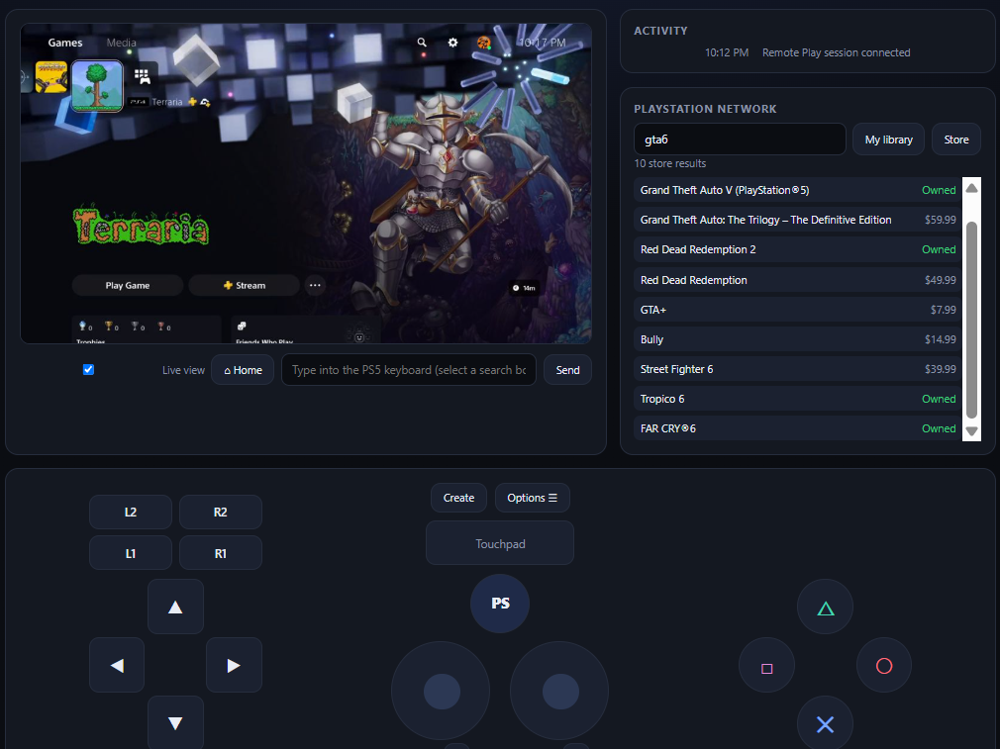
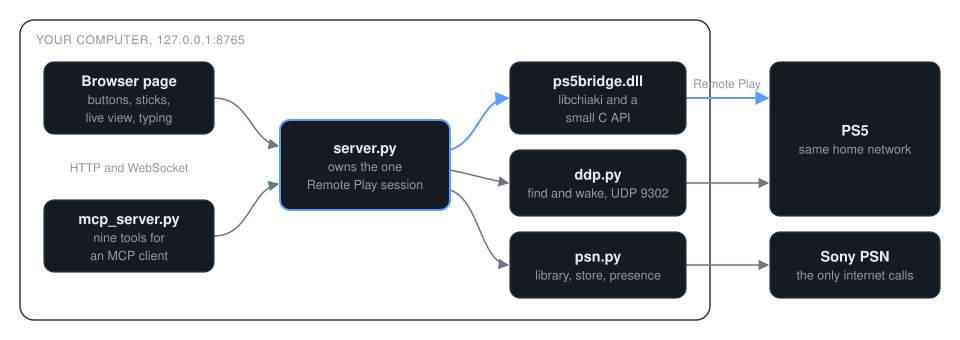

# PS5 Agent Remote

Control your PS5 from a browser or an AI agent.



<sub>The web remote, driving a real console over Remote Play. Image from 2026-11-03.</sub>

Connect it to your agent:

```powershell
.venv\Scripts\python.exe tools\connect_agents.py claude --apply
```

Untested on a clean machine. Start the remote with
`start.cmd` first. Then ask your agent "Do I own Elden Ring? If yes, start the
download." The agent searches your library, navigates the console, and checks
each step on a fresh screenshot.

PS5 Agent Remote runs a small server on your Windows PC. It connects to your PS5
over Sony's Remote Play protocol on your home network. The server listens on
127.0.0.1 only.

## Example

These prompts come from the [agent guide](docs/03-agents.md):

- "What's on my PS5 right now?"
- "Open YouTube and search for lo-fi hip hop."
- "Is there anything good on sale under $20 in the PlayStation Store?"
- "Put the PS5 in rest mode."

## Tools

Nine MCP tools, defined in [`mcp_server.py`](mcp_server.py).

| Tool | What it does | Access |
| --- | --- | --- |
| `ps5_look` | Returns a screenshot and a status line. Options enhance dark scenes and zoom into a HUD. | Read |
| `ps5_press` | Presses buttons in order, then returns a screenshot. | Console input |
| `ps5_play` | Runs timed stick, button and trigger states on the server clock, and returns frames captured during the run. | Console input |
| `ps5_type` | Types into the PS5 keyboard. A text field must be selected first. | Console input |
| `ps5_home` | Goes to the Home screen. | Console input |
| `ps5_power` | Wakes the PS5 or puts it in rest mode. | Console power |
| `psn_library` | Searches your owned and played games. | Read |
| `psn_store_search` | Searches the PlayStation Store with prices and ownership. | Read |
| `psn_now_playing` | Shows what your account is playing now. | Read |

Every tool declares the four MCP hints (`readOnlyHint`, `destructiveHint`,
`idempotentHint`, `openWorldHint`) as explicit booleans. The input tools are
marked destructive and open world, because a button press can confirm any dialog
on the console, a store purchase included.
The table is in [03 Agents](docs/03-agents.md#the-tools).

`ps5_play` lets an agent play a game. The server runs the whole input list on
its own clock, so the agent can walk, jump and aim, then read what happened from
the frames.

## Connect

Requires Windows 10 or 11, 64-bit, Python 3.11 or newer, and a PS5 on the same
home network with a PlayStation Network account signed in.

1. **Install** Python, this project and its packages. See [01 Install](docs/01-install.md).
2. **Prepare the PS5.** Turn on Remote Play and network wake. See [02 PS5 setup](docs/02-ps5-setup.md).
3. **Start it.** Double-click `start.cmd`. Your browser opens `http://127.0.0.1:8765`.
4. **Sign in and link.** Paste your PSN sign-in token, then type the 8-digit PIN from the PS5.
5. **Connect your agent.** Run the command at the top of this page.

| Client | Setup | Clean-machine test |
| --- | --- | --- |
| Claude Code | `tools\connect_agents.py claude --apply` | Untested |
| Claude Desktop, Cursor, Windsurf | `tools\connect_agents.py json`, then merge the block ([guide](docs/03-agents.md)) | Untested |
| DeepSeek Harness | `tools\connect_agents.py dsh` ([guide](docs/03-agents.md)) | Untested |

## How it works

<picture>
  <source media="(prefers-color-scheme: dark)" srcset="assets/ps5-architecture-dark.svg">
  <source media="(prefers-color-scheme: light)" srcset="assets/ps5-architecture-light.svg">
  
</picture>

- **One session, two drivers.** `server.py` owns the Remote Play session. The page and the agent share it, so they never fight over the console.
- **A maintained protocol.** [`ps5bridge.dll`](native/bridge.c) is chiaki-ng's libchiaki plus a small C API. chiaki-ng tracks PS5 firmware changes.
- **A public binary build.** GitHub Actions builds the DLL from a tag with [`tools/build_native.py`](tools/build_native.py). The [release](https://github.com/Jeff-Kazzee/ps5-agent-remote/releases/tag/v0.1.0) publishes its SHA-256.
- **Video on demand.** `ps5native.py` decodes H.264 with PyAV and keeps only the newest frame for screenshots.
- **No relay.** The build replaces chiaki-ng's internet holepunch code with a stub. The only internet calls are PSN lookups to Sony.

The [HTTP API](docs/06-http-api.md) is open for your own scripts.

## Permissions and data

- **Reads:** the console screen, your PSN library, your presence and store prices.
- **Changes:** anything a controller can change on the console. This includes starting downloads.
- **Sends to other services:** PSN lookups go to Sony. Your agent's model provider receives the screenshots and results that your agent reads.
- **Credentials:** `.env.local` holds your PSN sign-in token. `~/.ps5-remote/consoles.json` holds the keys that link this computer to your PS5. Treat both like passwords.

The server gives agents rules. Agents must stop before any purchase, pre-order or
subscription and ask you. They must not change settings, delete games or saves,
nor accept new terms without asking.

These rules are instructions to the agent. They are not a code lock. For a hard
stop, turn on **Require password at checkout** on the PS5. See
[the setup guide](docs/02-ps5-setup.md#24-recommended-require-a-password-for-purchases).

## Status

Version [0.1.0](https://github.com/Jeff-Kazzee/ps5-agent-remote/releases/tag/v0.1.0),
published 2026-11-03. Early alpha. Windows only.

Known limits:

- Video apps hide the picture. While YouTube, Netflix and similar apps are on screen, the PS5 sends Remote Play a black picture. Buttons still work, and **Home** brings the picture back.
- Download progress and system updates have no network API. Agents read them from the console screen.
- It runs one Remote Play session at a time. The official app or chiaki-ng disconnects this one.
- Consoles with a user login passcode are not supported yet.
- The PIN linking step with the native library has not been tested end to end on a second PS5.
- Unit tests cover all nine MCP tools against a fake remote server ([`tests/`](tests)). Nothing tests a real console automatically. CI builds the native library and runs the unit tests. Smoke checks that need a PS5 are in [`tools/`](tools).

Not affiliated with or endorsed by Sony Interactive Entertainment. "PlayStation"
and "PS5" are trademarks of Sony Interactive Entertainment Inc.

## Documentation

| Guide | What it covers |
| --- | --- |
| [01 Install](docs/01-install.md) | Python, download, packages, the native library |
| [02 PS5 setup](docs/02-ps5-setup.md) | Console settings, sign-in, linking, purchase safety |
| [03 Agents](docs/03-agents.md) | MCP clients and the tools |
| [04 Using the remote](docs/04-using-the-remote.md) | The web page, shortcuts, live view, typing |
| [05 Troubleshooting](docs/05-troubleshooting.md) | Black screen, console not found, linking errors |
| [06 HTTP API](docs/06-http-api.md) | Endpoints for your own scripts |
| [07 Building the native library](docs/07-building.md) | Compile `ps5bridge.dll` yourself |

## License

The server, web remote, agent tools, PSN code and docs are MIT. See
[LICENSE](LICENSE).

The native engine (`native/` sources, `tools/build_native.py` and the released
`ps5bridge.dll`) is AGPL-3.0. It is built from chiaki-ng's libchiaki. See
[native/LICENSE-AGPL-3.0](native/LICENSE-AGPL-3.0) and
[THIRD_PARTY.md](THIRD_PARTY.md).

[](https://m8ven.ai/mcp/jeff-kazzee-ps5-agent-remote-4x46zm?s=readme)
[](https://m8ven.ai/mcp/jeff-kazzee/ps5-agent-remote?s=readme)
